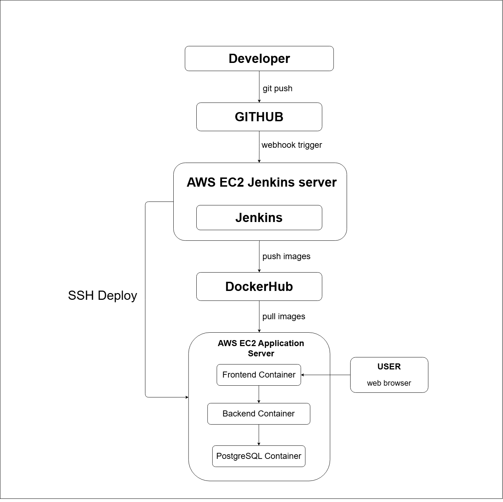
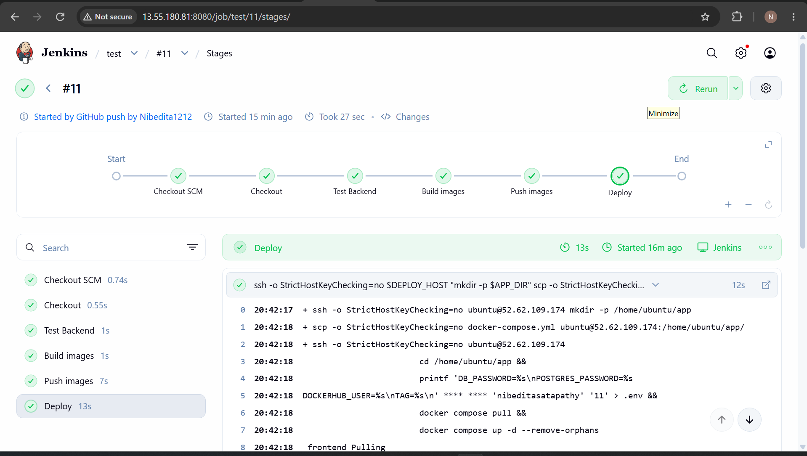
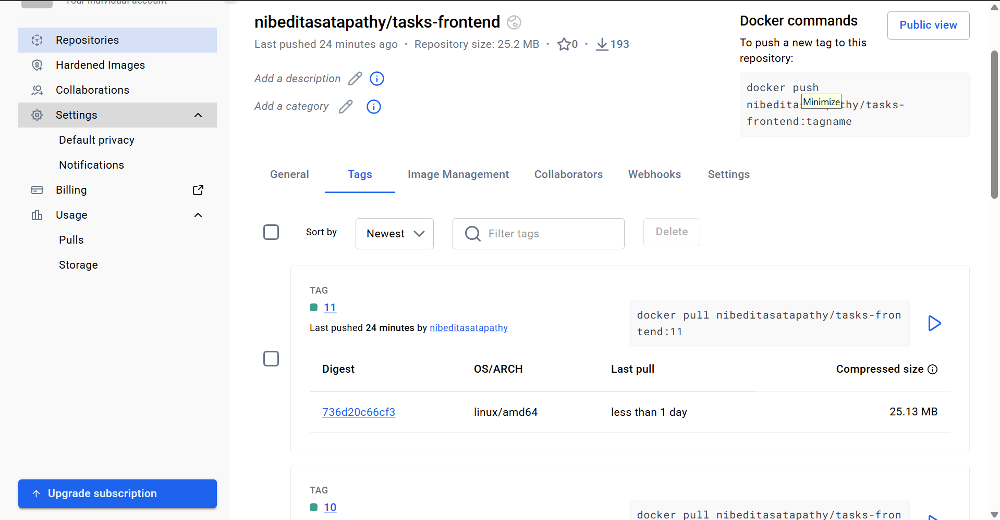
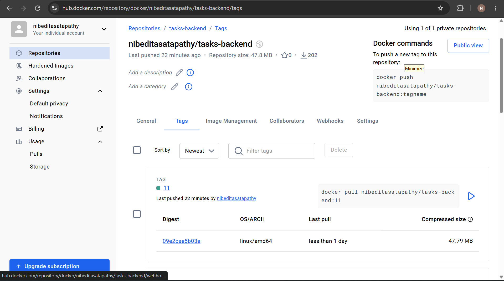
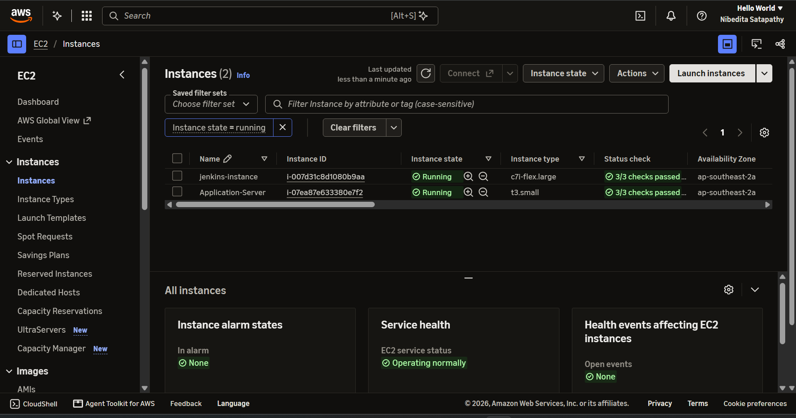
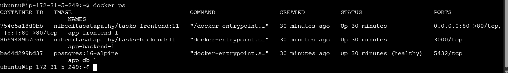
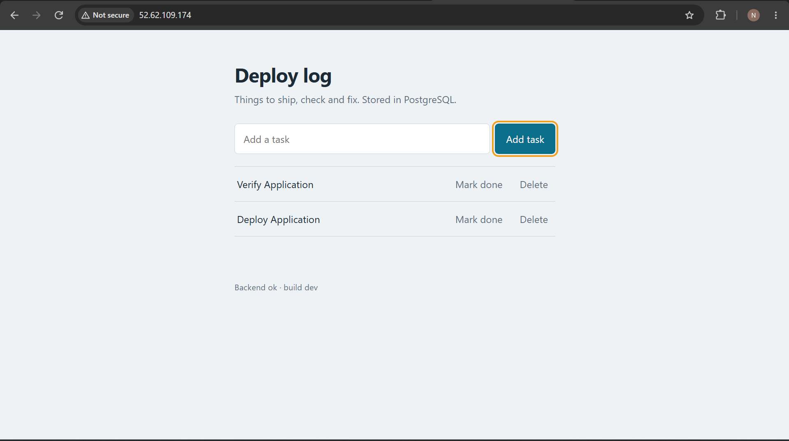

# Tasks-app-devops-cicd-pipeline -- DevOps CI/CD Project
## Project Overview
This project demonstrates the deployment of a 3-tier web application using DevOps tools and practices. It includes a frontend, a Node.js backend, and a PostgreSQL database. Docker is used to run the application components in containers, while Jenkins automates the build and deployment process to AWS EC2.
## Architecture Diagram
The diagram below shows the CI/CD workflow and the application components.


## Technology Stack
| Area | Technology |
| :--- | :--- |
| Source code management | Git, GitHub |
| CI/CD | Jenkins |
| Containerization | Docker, Docker Compose |
| Container image registry | Docker Hub |
| Cloud infrastructure | AWS EC2 |
| Backend | Node.js |
| Database | PostgreSQL |
| Frontend | HTML, CSS, JavaScript, Nginx |

The application has three main layers:
1.	**Frontend:** The web interface built with HTML, CSS, and JavaScript.
2.	**Backend:** A Node.js API that handles application requests and communicates with the database.
3.	**Database:** PostgreSQL stores the application data.
   
The frontend communicates with the backend API. The backend connects to PostgreSQL. The frontend does not connect directly to the database.

## DevOps Workflow
1.	Application source code is maintained in GitHub.
2.	A GitHub webhook triggers the Jenkins pipeline when code is pushed.
3.	Jenkins checks out the repository and runs the configured pipeline stages.
4.	Docker images are built for the frontend and backend.
5.	Jenkins pushes the images to Docker Hub.
6.	Jenkins connects to the AWS application EC2 instance over SSH.
7.	The application server pulls the required images from Docker Hub and starts the updated containers.
   
The exact pipeline stages and deployment commands are defined in the project's Jenkinsfile and Docker Compose configuration.

## AWS Infrastructure
The project uses two EC2 instances:
•	**Jenkins EC2:** Runs Jenkins and executes the CI/CD pipeline. Docker is also available here for building images.
•	**Application EC2:** Hosts the application containers using Docker.

Jenkins connects to the application EC2 instance over SSH to perform deployment tasks. Keep SSH access restricted to the Jenkins server's security group or trusted source. Do not store private keys or passwords in the Git repository.

## Repository Structure
```text
tasks-app-devops-cicd-pipeline/
├── frontend/
├── backend/
├── screenshots/
├── docker-compose.yml
├── Jenkinsfile
├── README.md
└── Devloper-README.md
```

Running the Application Locally
1.	Install Docker and Docker Compose.
2.	Clone this repository:
```
git clone https://github.com/Nibedita1212/tasks-app-devops-cicd-pipeline.git
cd tasks-app-devops-cicd-pipeline
```
3.	Create a .env file in the root directory to configure your required environment variables:
```env
POSTGRES_PASSWORD=your_secure_password
DOCKERHUB_USER=your_dockerhub_username
TAG=latest
```
5.	Start the application:
`docker compose up -d --build`
6.	Check the running containers:
`docker compose ps`
7.	View application logs if needed:
`docker compose logs -f`
8.  Access the application in your browser at:http://localhost <br>
   To stop the application:
`docker compose down`
## CI/CD Pipeline
The Jenkins pipeline is defined in the `Jenkinsfile`. It automates the configured build, image publishing, and deployment steps.
*	GitHub webhook integration triggers the pipeline.
*	Docker images are built and pushed to Docker Hub.
*	Jenkins uses configured credentials for Docker Hub and SSH deployment.
*	The application EC2 instance pulls the images and runs the containers.

## Screenshots

| Screenshot | What to show |
| :--- | :--- |
| **Jenkins Pipeline** |  |
| **Docker Hub – Frontend** |  |
| **Docker Hub – Backend** |  |
| **AWS EC2 Instances** |  |
| **Application Containers** |  |
| **Live Application** |  |

## Security Notes
* Do not commit `.env` files, passwords, database credentials, private SSH keys, `.pem` files, or certificates.
* Store sensitive values in Jenkins Credentials or a protected environment configuration.
* Use a `.gitignore` file to exclude secrets and local/generated files.
* Restrict inbound SSH access to trusted sources.

## Future Improvements
* Add application health checks and monitoring.
* Add automated database backup and recovery.
* Improve deployment rollback and release management.
* Add infrastructure provisioning with Terraform.
* Add container orchestration when required.

## Author
* **Project:** tasks-app-devops-cicd-pipeline  
* **GitHub:** [https://github.com/Nibedita1212/tasks-app-devops-cicd-pipeline](https://github.com/Nibedita1212/tasks-app-devops-cicd-pipeline)

